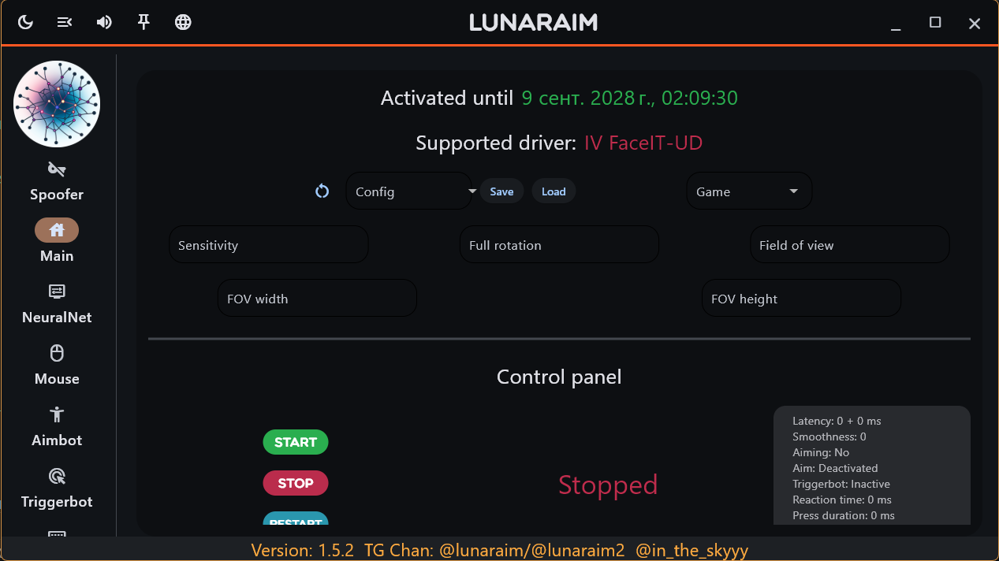
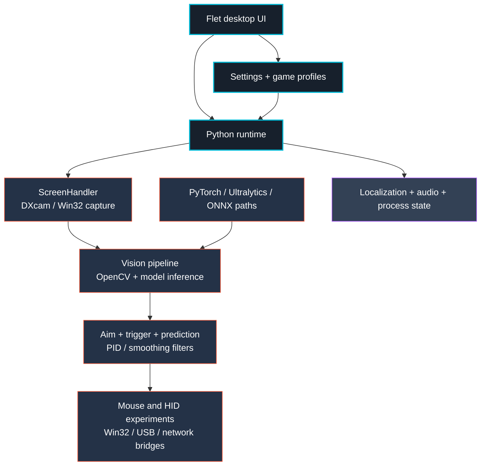
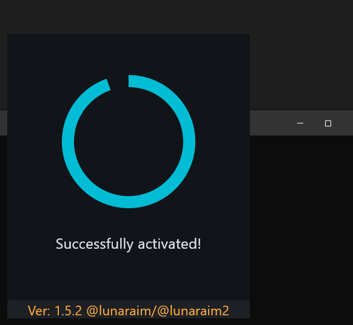

  

  
  
  

<h3 align="center">Built with</h3>

  
  
  
  
  
  
  
  

Table of contents

 

- [About this archive](#about-this-archive)
- [What the project explored](#what-the-project-explored)
- [Architecture overview](#architecture-overview)
- [Interface gallery](#interface-gallery)
  - [Main control surface](#main-control-surface)
  - [Loading and activation](#loading-and-activation)
- [Archive status](#archive-status)
- [Repository contents](#repository-contents)
- [License](#license)

> **Archive notice.** LunarEngine is a historical research snapshot from 2023–2025. It is not a maintained product, not a setup guide, and not intended for practical use or adaptation. The project is preserved for educational review of its architecture, UI, and experimental computer-vision pipeline.

## About this archive

LunarEngine was an experimental Windows desktop application built around a configurable control surface, real-time screen processing, model-assisted detection, and modular input/output experiments.

The repository is intentionally presented as a snapshot of the work rather than a current release. Its original runtime is obsolete, its target environment has changed, and the implementation contains exploratory code, hardcoded assumptions, and incomplete components.

## What the project explored

- **Desktop control surface.** A dark Flet-based UI brought configuration, runtime state, game profiles, input settings, and diagnostics into one interface.
- **Real-time capture.** The screen pipeline used DXcam and Windows capture APIs to feed frames into the processing loop.
- **Computer vision.** OpenCV color segmentation and model-backed detection paths were explored alongside PyTorch, Ultralytics, and ONNX-related tooling.
- **Control logic.** Aim, trigger, prediction, smoothing, PID filtering, and configurable target geometry were developed as separate experimental components.
- **Input experiments.** The code contains Windows input paths, HID/USB abstractions, network-based mouse bridges, and driver-facing placeholders.
- **Configuration and localization.** Per-game configuration snapshots, bindings, locale strings, and runtime feature flags were part of the application model.

## Architecture overview

## Interface gallery

The archived UI reflects the project’s focus on runtime visibility and dense configuration. The screenshots are preserved as visual documentation, not as a promise of current compatibility.

### Main control surface

  

The main surface combines game and configuration selection, activation state, control actions, runtime metrics, and navigation across the project’s feature areas.

### Loading and activation

  

The loading screen documents the application’s startup flow and activation feedback in the archived build.

## Archive status

This repository is **read-only in spirit** and exists as a historical reference.

- The original README states that the code no longer works with current game versions.
- No supported installation or runtime workflow is provided.
- The code was written for Python 3.11 and contains no maintained test suite.
- Several components are intentionally incomplete or excluded, including the real external mouse-driver implementation.
- Do not use this archive to modify games, bypass protections, build cheats, or adapt the code for current software.

## Repository contents

Explore the archived source areas

 

- `app_main.py`, `naim_*.py` — Flet application shell, navigation, settings, and loading flow.
- `screen_handler.py`, `predictor.py` — frame capture and detection pipeline.
- `aim.py`, `aim_mouse.py`, `mouse_filter.py` — experimental control, smoothing, and mouse coordination.
- `color_boundings.py`, `compiler.py` — color segmentation and model/runtime loading paths.
- `configs/` — historical per-game and feature configuration snapshots.
- `locales.py`, `media/`, `logo.png` — localization and interface assets.
- `requirements.txt` — archived dependency inventory.

## License

This project is distributed under the [MIT License](LICENSE). The archive should be read together with the project’s safety notice and attribution requirements.

 

  
  <h2>LunarEngine</h2>
  Historical Windows research snapshot · 2023–2025

