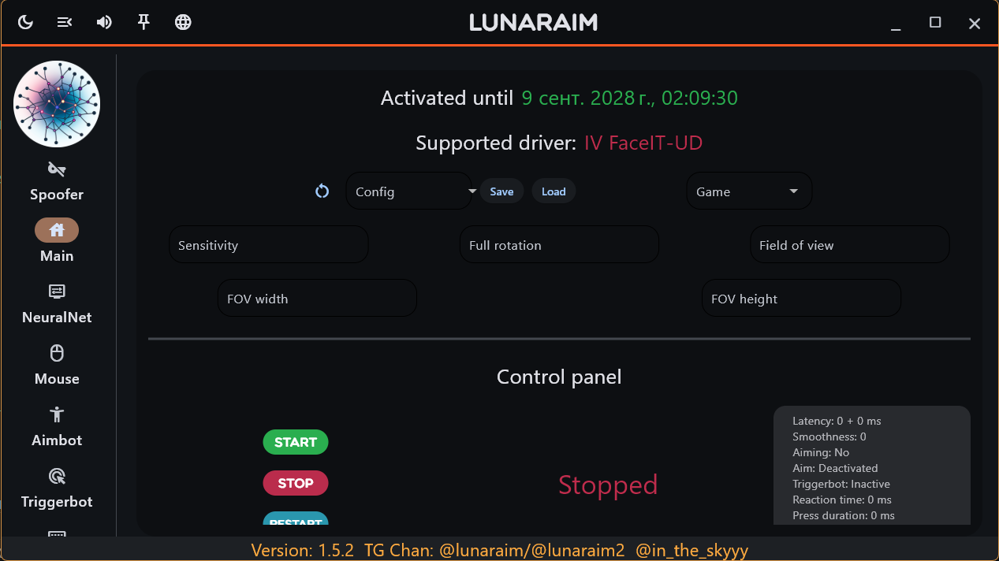
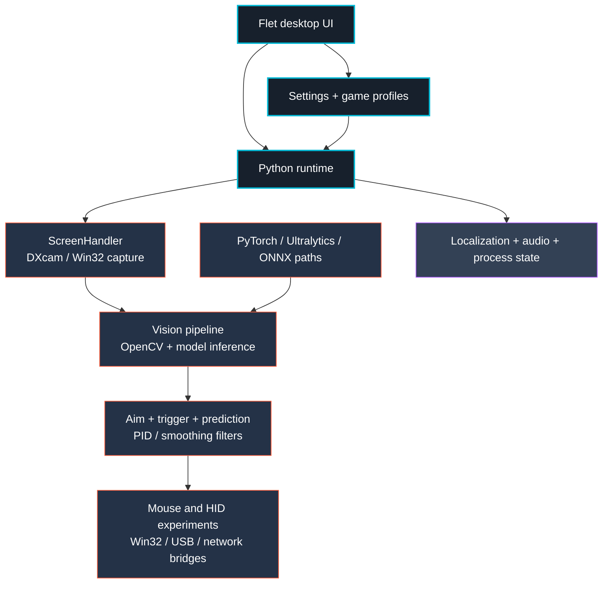
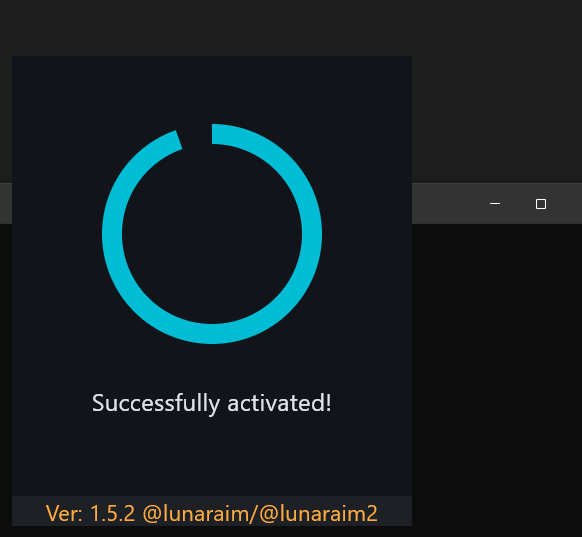
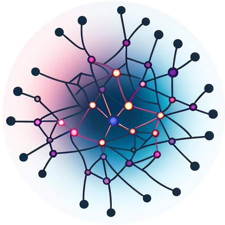

  

  
  
  

<a href="README.md">English</a> · <a href="README.ru-RU.md">Русский</a> · <a href="README.zh-CN.md">简体中文</a>

<h3 align="center">Создано с помощью</h3>

  
  
  
  
  
  
  
  

Содержание

 

- [Об архиве](#об-архиве)
- [Что исследовал проект](#что-исследовал-проект)
- [Обзор архитектуры](#обзор-архитектуры)
- [Галерея интерфейса](#галерея-интерфейса)
  - [Главная панель управления](#главная-панель-управления)
  - [Загрузка и активация](#загрузка-и-активация)
- [Статус архива](#статус-архива)
- [Содержимое репозитория](#содержимое-репозитория)
- [Лицензия](#лицензия)

> **Уведомление об архиве.** LunarEngine — исторический research snapshot 2023–2025 годов. Это не поддерживаемый продукт, не инструкция по запуску и не проект для практического использования или адаптации. Репозиторий сохранён для образовательного изучения архитектуры, UI и экспериментального computer-vision pipeline.

## Об архиве

LunarEngine — экспериментальное Windows-приложение с настраиваемой панелью управления, обработкой экрана в реальном времени, model-assisted detection и модульными экспериментами с вводом/выводом.

Репозиторий намеренно представлен как snapshot работы, а не как текущий release. Исходный runtime устарел, целевая среда изменилась, а реализация содержит экспериментальный код, hardcode и незавершённые компоненты.

## Что исследовал проект

- **Desktop control surface.** Тёмный UI на Flet объединял конфигурацию, состояние runtime, игровые профили, настройки ввода и диагностику.
- **Real-time capture.** Pipeline использовал DXcam и Windows capture API для передачи кадров в обработку.
- **Computer vision.** Исследовались OpenCV color segmentation и model-backed detection с PyTorch, Ultralytics и инструментами ONNX.
- **Control logic.** Aim, trigger, prediction, smoothing, PID-фильтрация и настраиваемая геометрия целей развивались как отдельные экспериментальные компоненты.
- **Input experiments.** Код содержит Windows input paths, HID/USB-абстракции, сетевые mouse bridges и placeholders для driver-интеграций.
- **Configuration and localization.** В модель приложения входили игровые конфиги, bindings, locale strings и runtime feature flags.

## Обзор архитектуры

## Галерея интерфейса

Архивный UI отражает фокус проекта на наблюдаемости runtime и плотной конфигурации. Снимки сохранены как визуальная документация, а не как обещание совместимости с текущим ПО.

### Главная панель управления

  

Главная панель объединяет выбор игры и конфигурации, статус активации, управляющие действия, runtime-метрики и навигацию по функциональным разделам проекта.

### Загрузка и активация

  

Экран загрузки показывает startup flow приложения и feedback активации в архивной сборке.

## Статус архива

Репозиторий существует как исторический reference и по смыслу является **read-only**.

- Исходный README указывает, что код больше не работает с актуальными версиями игр.
- Поддерживаемый workflow установки и запуска не предоставляется.
- Код написан для Python 3.11 и не содержит поддерживаемого test suite.
- Некоторые компоненты намеренно незавершены или исключены, включая настоящую реализацию внешнего mouse driver.
- Не используйте архив для модификации игр, обхода защит, создания читов или адаптации под современное ПО.

## Содержимое репозитория

Архивные области исходников

 

- `app_main.py`, `naim_*.py` — Flet shell приложения, навигация, настройки и loading flow.
- `screen_handler.py`, `predictor.py` — pipeline захвата кадров и детекции.
- `aim.py`, `aim_mouse.py`, `mouse_filter.py` — экспериментальные control, smoothing и координация мыши.
- `color_boundings.py`, `compiler.py` — color segmentation и пути загрузки моделей/runtime.
- `configs/` — исторические конфигурации игр и функций.
- `locales.py`, `media/`, `logo.png` — локализация и UI-материалы.
- `requirements.txt` — архивный список зависимостей.

## Лицензия

Проект распространяется под [MIT License](LICENSE). Архив следует рассматривать вместе с уведомлением о безопасности и требованиями к атрибуции.

 

  
  <h2>LunarEngine</h2>
  Исторический Windows research snapshot · 2023–2025

