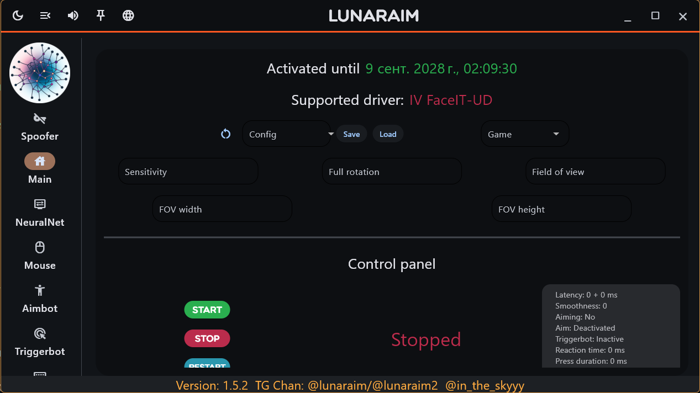
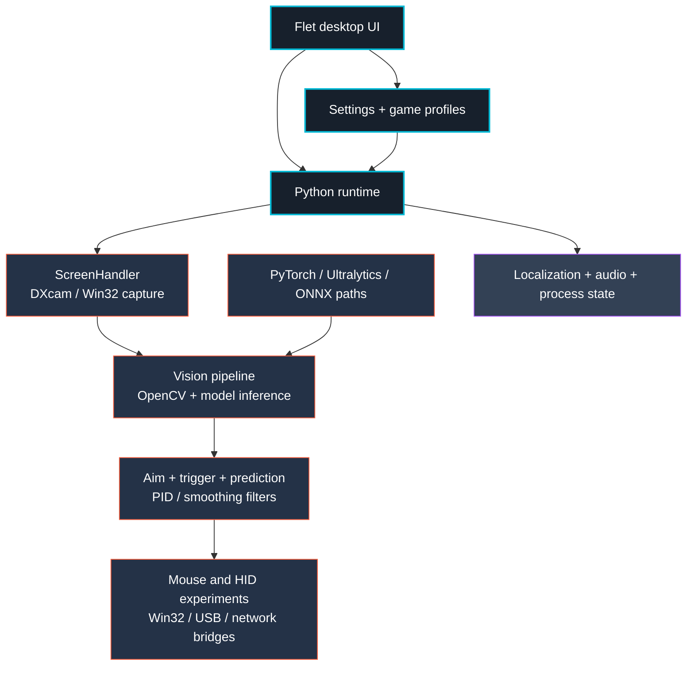
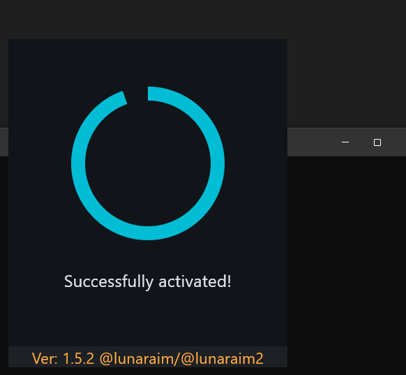
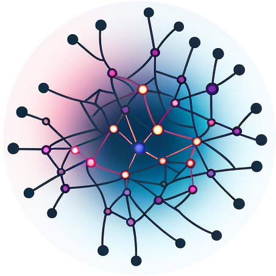

  

  
  
  

<a href="README.md">English</a> · <a href="README.ru-RU.md">Русский</a> · <a href="README.zh-CN.md">简体中文</a>

<h3 align="center">构建技术</h3>

  
  
  
  
  
  
  
  

目录

 

- [关于此归档](#关于此归档)
- [项目探索的内容](#项目探索的内容)
- [架构概览](#架构概览)
- [界面画廊](#界面画廊)
  - [主控制界面](#主控制界面)
  - [加载与激活](#加载与激活)
- [归档状态](#归档状态)
- [仓库内容](#仓库内容)
- [许可证](#许可证)

> **归档说明。** LunarEngine 是 2023–2025 年的历史研究快照。它不是维护中的产品、不是安装指南，也不用于实际使用或改造。该项目用于教育性地了解其架构、UI 和实验性计算机视觉 pipeline。

## 关于此归档

LunarEngine 是一个实验性的 Windows 桌面应用，围绕可配置的控制界面、实时屏幕处理、模型辅助检测以及模块化输入/输出实验构建。

本仓库被有意保留为工作过程的 snapshot，而不是当前 release。原始 runtime 已经过时，目标环境也已变化，代码中包含实验性实现、hardcode 和未完成组件。

## 项目探索的内容

- **Desktop control surface。** 基于 Flet 的深色 UI 将配置、runtime 状态、游戏 profiles、输入设置和诊断集中在一个界面中。
- **Real-time capture。** 屏幕 pipeline 使用 DXcam 和 Windows capture API，将帧传入处理流程。
- **Computer vision。** 结合 PyTorch、Ultralytics 以及 ONNX 相关工具，探索 OpenCV 颜色分割和模型检测路径。
- **Control logic。** Aim、trigger、prediction、smoothing、PID filter 和可配置目标几何被作为独立实验组件开发。
- **Input experiments。** 代码包含 Windows input 路径、HID/USB 抽象、网络 mouse bridge 以及 driver 集成 placeholder。
- **Configuration and localization。** 应用模型包含各游戏配置、bindings、locale 字符串和 runtime feature flags。

## 架构概览

## 界面画廊

归档 UI 体现了项目对 runtime 可观测性和密集配置的关注。截图作为视觉文档保存，并不代表当前兼容性。

### 主控制界面

  

主界面整合了游戏和配置选择、激活状态、控制操作、runtime 指标以及项目功能区域的导航。

### 加载与激活

  

加载界面展示了归档版本中的启动流程和激活反馈。

## 归档状态

本仓库作为历史参考存在，在实际意义上是 **read-only**。

- 原始 README 说明代码已无法适配当前游戏版本。
- 不提供受支持的安装或运行流程。
- 代码面向 Python 3.11，且没有维护中的测试套件。
- 一些组件有意不完整或被排除，包括真正的外部 mouse driver 实现。
- 不要使用此归档来修改游戏、绕过保护、构建作弊工具或适配当前软件。

## 仓库内容

查看归档源码区域

 

- `app_main.py`、`naim_*.py` — Flet 应用 shell、导航、设置和加载流程。
- `screen_handler.py`、`predictor.py` — 帧捕获和检测 pipeline。
- `aim.py`、`aim_mouse.py`、`mouse_filter.py` — 实验性的 control、smoothing 和鼠标协调。
- `color_boundings.py`、`compiler.py` — 颜色分割和模型/runtime 加载路径。
- `configs/` — 历史游戏及功能配置快照。
- `locales.py`、`media/`、`logo.png` — 本地化和 UI 资源。
- `requirements.txt` — 归档依赖清单。

## 许可证

本项目采用 [MIT License](LICENSE) 发布。阅读归档时请同时遵守项目安全说明和署名要求。

 

  
  <h2>LunarEngine</h2>
  历史 Windows research snapshot · 2023–2025

